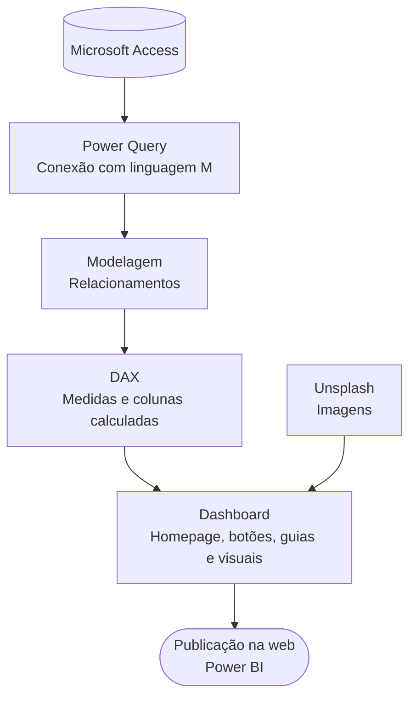
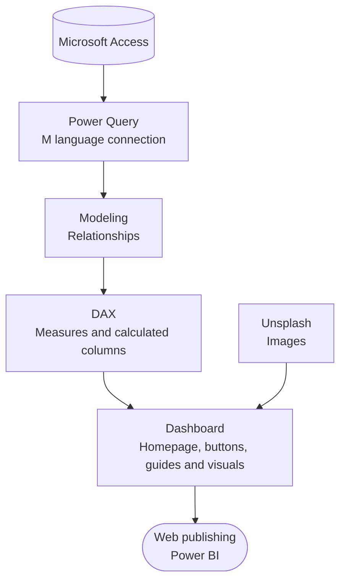

# Adventure Works

**🌐 Idioma / Language:** [Português](#pt) | [English](#en)

---

## 🇧🇷 Português

### 📌 Sobre o projeto

O **Adventure Works** foi desenvolvido durante o curso **"Técnicas Avançadas de Power BI"**, ministrado por Karine Lago.

O objetivo é demonstrar a conexão entre o Microsoft Access e o Power Query do Power BI e transformar os dados em informações úteis em formato de dashboard.

### 🗂️ Fonte de dados

- **Origem:** arquivo do Microsoft Access.
- **Conteúdo:** informações básicas de produtos, pedidos e outros detalhes da empresa.
- **Observação:** a Adventure Works é uma empresa fictícia, e sua base é muito conhecida por quem faz cursos que usam fontes de dados da Microsoft.

### ⚙️ Desenvolvimento

1. **Conexão:** realizada com a linguagem M no Power Query.
2. **Tratamento:** não foram necessários ajustes consideráveis, pois os dados já vieram padronizados e de fácil compreensão.
3. **Modelagem:** relacionamentos, medidas e colunas calculadas, com lógica de programação e fórmulas DAX.
4. **Visualização:** dashboard mais harmônico e sustentável, com poucas ou praticamente nenhuma tabela, sem deixar de apresentar as informações importantes.

### 🔀 Fluxo do projeto
 

### ✨ Funcionalidades

- Página inicial (homepage)
- Botões
- Guias informativas
- Diferentes visuais disponíveis no Power BI

### 💼 Valor gerado e ganhos de negócio
 
O projeto transforma os dados armazenados no Microsoft Access em uma visão visual e navegável, para apoiar a tomada de decisão. Aplicada em um cenário real, a solução pode gerar:
 
| Valor gerado | Ganho de negócio potencial |
|---|---|
| Informações de produtos e pedidos reunidas em um dashboard | Visão mais clara da operação |
| Visuais no lugar de tabelas extensas | Leitura e interpretação mais rápidas |
| Medidas em DAX com regras definidas no modelo | Indicadores calculados de forma consistente |
| Conexão estruturada no Power Query | Menos trabalho manual na atualização das análises |
| Homepage, botões e guias informativas | Uso mais intuitivo por quem não é da área técnica |
| Publicação na web | Acesso e compartilhamento facilitados |
 
> **Nota:** por se tratar de um projeto de estudo com uma empresa fictícia, os ganhos são potenciais e não foram medidos.

### 🛠️ Tecnologias utilizadas

| Tecnologia | Finalidade |
|---|---|
| Power BI | Construção do dashboard |
| Microsoft Access | Banco de dados |
| Linguagem M | Conexão dos dados no Power Query |
| DAX | Medidas e colunas calculadas |
| Unsplash | Imagens de uso gratuito |

### 🔗 Acesso

O dashboard está disponível em: [Adventure Works](https://app.powerbi.com/view?r=eyJrIjoiMWE4NzgzZjItN2NmMS00NzZhLWIwNWEtNzUyMTU2OTMwNWNmIiwidCI6ImNmNzJlMmJkLTdhMmItNDc4My1iZGViLTM5ZDU3YjA3Zjc2ZiIsImMiOjR9&embedImagePlaceholder=true)

### 📚 Aprendizados

Por já trabalhar com Power BI no dia a dia, resolvi ir um passo além do curso e aplicar um design mais elaborado, com o objetivo de quebrar o paradigma de que o Power BI se limita a ser um Microsoft Excel mais "bonito".

[⬆️ Voltar ao topo](#topo)

---

## 🇺🇸 English

### 📌 About the project

**Adventure Works** was developed during the **"Advanced Power BI Techniques"** course, taught by Karine Lago.

Its goal is to demonstrate the connection between Microsoft Access and Power BI's Power Query, and to turn the data into useful information in a dashboard.

### 🗂️ Data source

- **Origin:** Microsoft Access file.
- **Content:** basic information on products, orders and other company details.
- **Note:** Adventure Works is a fictitious company, and its database is well known to those who take courses based on Microsoft data sources.

### ⚙️ Development

1. **Connection:** built with M language in Power Query.
2. **Preparation:** no significant cleaning was required, as the data was already standardized and easy to understand.
3. **Modeling:** relationships, measures and calculated columns, using programming logic and DAX formulas.
4. **Visualization:** a more harmonious and sustainable dashboard, with few or almost no tables, while still presenting critical information.

### 🔀 Project flow
 

### ✨ Features

- Homepage
- Buttons
- Informative guides
- A variety of Power BI visuals

### 💼 Value delivered and business gains
 
The project turns the data stored in Microsoft Access into a visual, navigable view to support decision-making. Applied to a real scenario, the solution can deliver:
 
| Value delivered | Potential business gain |
|---|---|
| Product and order information brought together in a dashboard | A clearer view of the operation |
| Visuals instead of long tables | Faster reading and interpretation |
| DAX measures with rules defined in the model | Consistently calculated indicators |
| Structured connection in Power Query | Less manual work to update analyses |
| Homepage, buttons and informative guides | More intuitive use for non-technical people |
| Web publishing | Easier access and sharing |
 
> **Note:** as this is a study project based on a fictitious company, these gains are potential and have not been measured.

### 🛠️ Technologies used

| Technology | Purpose |
|---|---|
| Power BI | Dashboard development |
| Microsoft Access | Database |
| M language | Data connection in Power Query |
| DAX | Measures and calculated columns |
| Unsplash | Royalty-free images |

### 🔗 Access

The dashboard is available at: [Adventure Works](https://app.powerbi.com/view?r=eyJrIjoiMWE4NzgzZjItN2NmMS00NzZhLWIwNWEtNzUyMTU2OTMwNWNmIiwidCI6ImNmNzJlMmJkLTdhMmItNDc4My1iZGViLTM5ZDU3YjA3Zjc2ZiIsImMiOjR9&embedImagePlaceholder=true)

### 📚 Lessons learned

Since I already work with Power BI daily, I decided to go a step beyond the course and apply a more refined design, aiming to break the paradigm that Power BI is just a "prettier" version of Microsoft Excel.

[⬆️ Back to top](#topo)
