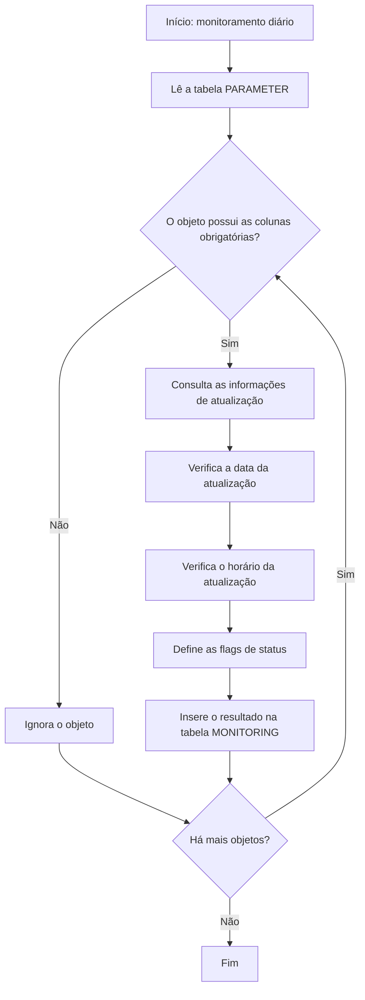
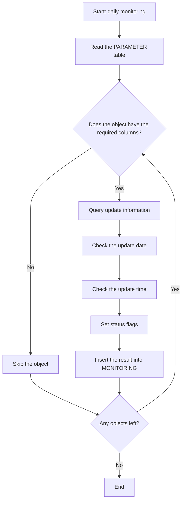

# Database Update Monitoring 

🌐 Idioma / Language: [Português](#pt) | [English](#en)

---

---

## 🇧🇷 Português

### 📌 Sobre o projeto

Solução que rastreia, valida e reporta as rotinas e a frequência de atualização de bancos de dados. Seu objetivo é apoiar dashboards confiáveis e a tomada de decisão. A necessidade de desenvolvimento dessa solução surgiu em cenários no qual o banco de dados não conta com recursos simplificados de monitoramento de acompanhamento de atualização das bases de dados.

Esta documentação é voltada a desenvolvedores, analistas de dados, DBAs e usuários de negócio.

### 🗂️ Fonte de dados

A solução usa duas tabelas: `PARAMETER`, com as regras, e `MONITORING`, com os resultados.

#### Tabela PARAMETER

Armazena as regras padrão de atualização de cada objeto monitorado.

| Coluna | Descrição |
| --- | --- |
| `SCHEMA_NAME` | Nome do schema |
| `OBJECT_NAME` | Nome do objeto |
| `OBJECT_TYPE` | Tipo do objeto (TABLE/VIEW) |
| `FREQUENCY_TYPE` | Frequência de atualização |
| `UPDATE_TIME` | Horário previsto para a atualização |
| `UPDATE_TYPE` | Regra de atualização |

#### Tabela MONITORING

Registra o status e os detalhes das atualizações. Permite acompanhar se os dados estão atualizados e confiáveis.

| Coluna | Descrição |
| --- | --- |
| `NU_SESSION` | Número da sessão de atualização |
| `DT_INSERT` | Data de inserção |
| `DT_LAST_UPDATE` | Data da última atualização |
| `SCHEMA_NAME` | Nome do schema |
| `OBJECT_NAME` | Nome do objeto |
| `FREQUENCY_TYPE` | Frequência de atualização |
| `ACTUAL_DATE` | Data de validação da atualização |
| `ESTIMATED_TIME` | Horário previsto para o início |
| `LIMIT_TIME` | Prazo limite para a atualização |
| `FINISH_TIME` | Horário real da atualização |
| `DATA_VOLUME` | Quantidade de linhas atualizadas |
| `UP_DATE_CHECK` | Status do dia da atualização |
| `UP_HOUR_CHECK` | Status do horário da atualização |
| `RESULT_UPDATE` | Resultado geral |

### ⚙️ Desenvolvimento

O procedimento `PRC_MONITORING` automatiza o monitoramento e verifica se as atualizações ocorrem no prazo e conforme as regras de negócio.

1. Identifica os objetos a monitorar na tabela `PARAMETER`.
2. Valida as colunas obrigatórias.
3. Coleta as informações de atualização.
4. Verifica o status de data e horário.
5. Registra os resultados na tabela `MONITORING`.
6. Aplica a retenção de dados (opcional).

**Variáveis principais**

- `v_query`: SQL dinâmico que busca as informações de atualização.
- `myrecord`: armazena os resultados da consulta.
- Flags de status: indicam a saúde da atualização.

### 🔄 Fluxo do projeto

### ✨ Funcionalidades

- Execução diária sobre todos os objetos configurados.
- Validação das atualizações e registro dos resultados.
- Alimentação de dashboards e alertas de confiabilidade dos dados.

### 💼 Valor gerado e ganhos de negócio

| Entrega | Ganho potencial |
| --- | --- |
| Procedimentos e tabelas reutilizáveis | Para desenvolvedores: integração mais simples em pipelines de ETL e dados |
| Validação diária das atualizações | Para analistas de dados: dados atualizados e rápida identificação de atrasos ou falhas |
| Monitoramento centralizado entre schemas | Para DBAs: apoio à conformidade e à auditoria |
| Dashboards transparentes e fáceis de entender | Para usuários de negócio: mais confiança nos dados |
| Automação do monitoramento | Para a organização: menos esforço manual e risco, gestão proativa e apoio à continuidade e à excelência operacional |

> **Nota:** os ganhos são potenciais, pois não há medições que os comprovem.

### 🛠️ Tecnologias utilizadas

| Tecnologia | Finalidade |
| --- | --- |
| Procedimento de banco de dados (`PRC_MONITORING`) | Automatizar o monitoramento |
| SQL dinâmico | Consultar as informações de atualização |

[⬆️ Voltar ao topo](#topo)

---

## 🇺🇸 English

### 📌 About the project

A solution that tracks, validates and reports on database update routines and their frequency. It is designed to support reliable dashboards and decision-making. This solutions was developed for those cenarios where there isn't a simple way to track database frequency update, principaly for business users and side areas that need to track database updates.

This documentation is for developers, data analysts, DBAs and business users.

### 🗂️ Data source

The solution uses two tables: `PARAMETER` holds the rules and `MONITORING` holds the results.

#### PARAMETER table

Stores the default update rules for each monitored object.

| Column | Description |
| --- | --- |
| `SCHEMA_NAME` | Schema name |
| `OBJECT_NAME` | Object name |
| `OBJECT_TYPE` | Object type (TABLE/VIEW) |
| `FREQUENCY_TYPE` | Update frequency |
| `UPDATE_TIME` | Scheduled update time |
| `UPDATE_TYPE` | Update rule |

#### MONITORING table

Records update status and details. It lets you track whether data is fresh and reliable.

| Column | Description |
| --- | --- |
| `NU_SESSION` | Update session number |
| `DT_INSERT` | Insert date |
| `DT_LAST_UPDATE` | Last update date |
| `SCHEMA_NAME` | Schema name |
| `OBJECT_NAME` | Object name |
| `FREQUENCY_TYPE` | Update frequency |
| `ACTUAL_DATE` | Date the update was validated |
| `ESTIMATED_TIME` | Scheduled start time |
| `LIMIT_TIME` | Update deadline |
| `FINISH_TIME` | Actual update time |
| `DATA_VOLUME` | Number of rows updated |
| `UP_DATE_CHECK` | Update day status |
| `UP_HOUR_CHECK` | Update time status |
| `RESULT_UPDATE` | Overall result |

### ⚙️ Development

The `PRC_MONITORING` procedure automates monitoring and checks that updates happen on time and follow business rules.

1. Identify the objects to monitor in the `PARAMETER` table.
2. Validate the required columns.
3. Gather update information.
4. Check date and time status.
5. Record the results in the `MONITORING` table.
6. Apply data retention (optional).

**Key variables**

- `v_query`: dynamic SQL that fetches update information.
- `myrecord`: stores the query results.
- Status flags: show the health of each update.

### 🔀  Project flow

### ✨ Features

- Daily run across all configured objects.
- Update validation and result logging.
- Data feed for data reliability dashboards and alerts.

### 💼 Value delivered and business gains

| Deliverable | Potential gain |
| --- | --- |
| Reusable procedures and tables | For developers: easier integration into ETL and data pipelines |
| Daily update validation | For data analysts: up-to-date data and quick detection of late or missing updates |
| Centralized monitoring across schemas | For DBAs: support for compliance and audits |
| Transparent, easy-to-read dashboards | For business users: greater trust in the data |
| Automated monitoring | For the organization: less manual effort and risk, proactive management, and support for business continuity and operational excellence |

> **Note:** these are potential gains, as no measurements confirm them yet.

### 🛠️ Technologies used

| Technology | Purpose |
| --- | --- |
| Database procedure (`PRC_MONITORING`) | Automate monitoring |
| Dynamic SQL | Query update information |

[⬆️ Back to top](#topo)
