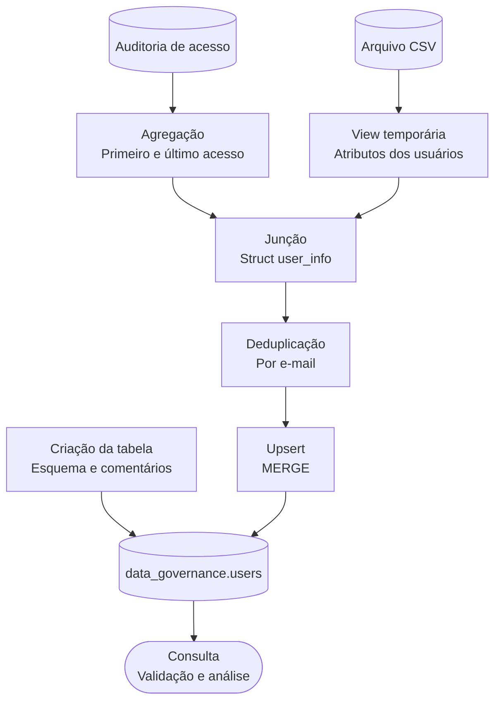
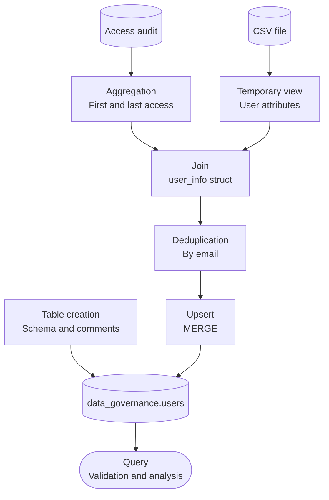

# User Management Notebook

**🌐 Idioma / Language:** [Português](#pt) | [English](#en)

---

## 🇧🇷 Português

### 📌 Sobre o projeto

O **User Management Notebook** automatiza a criação, a atualização e a consulta de uma tabela de usuários para governança de dados.

O objetivo é consolidar informações de auditoria de acesso e atributos de usuários em um repositório atualizado e confiável para governança e análises.

### 🗂️ Fonte de dados

- **Origem:** tabela de auditoria de acesso e arquivo CSV.
- **Conteúdo:** acessos por e-mail e atributos dos usuários.
- **Observação:** o caminho do CSV e a tabela de auditoria devem estar acessíveis e atualizados.

### ⚙️ Desenvolvimento

1. **Estrutura:** exclusão e criação da tabela `data_governance.users`, com chave primária, struct e comentários.
2. **Conexão:** leitura dos atributos do CSV em uma view temporária e uso da auditoria de acesso.
3. **Tratamento:** primeiro e último acesso por e-mail, junção dos dados, struct `user_info` e deduplicação.
4. **Carga:** upsert na tabela principal com `MERGE`.
5. **Validação:** consulta da tabela para validação e análise.

**Tabela**

**Pipeline**

### 🔀 Fluxo do projeto

### ✨ Funcionalidades

- Criação e documentação da tabela de usuários
- Cálculo do primeiro e do último acesso
- Integração de atributos a partir de CSV
- Deduplicação por e-mail
- Upsert com `MERGE`

### 💼 Valor gerado e ganhos de negócio

O projeto reúne auditoria de acesso e atributos em uma única tabela, para apoiar a governança de dados. A solução pode gerar:

| Valor gerado | Ganho de negócio potencial |
|---|---|
| Repositório centralizado de usuários | Apoio à governança, segurança e auditoria |
| Registro de acessos, status e atributos | Rastreabilidade dos usuários |
| Dados consolidados | Apoio à conformidade, aos relatórios e às decisões |
| Consolidação automatizada | Menos esforço manual |
| Deduplicação e upsert | Menor risco de dados inconsistentes |

> **Nota:** os ganhos são potenciais e não foram medidos.

### 🛠️ Tecnologias utilizadas

| Tecnologia | Finalidade |
|---|---|
| Notebook | Lógica de consolidação |
| Pipeline | Pipeline de dados do projeto |
| CSV | Atributos dos usuários |
| `MERGE` | Upsert na tabela principal |

[⬆️ Voltar ao topo](#topo)

---

## 🇺🇸 English

### 📌 About the project

**User Management Notebook** automates how a user table is created, updated and queried for data governance.

Its goal is to consolidate access audit data and user attributes into an up-to-date, reliable repository for governance and analytics.

### 🗂️ Data source

- **Origin:** access audit table and CSV file.
- **Content:** accesses by email and user attributes.
- **Note:** the CSV path and the audit table must be accessible and up to date.

### ⚙️ Development

1. **Structure:** drop and create the `data_governance.users` table, with a primary key, a struct and comments.
2. **Connection:** read CSV attributes into a temporary view and use the access audit data.
3. **Preparation:** first and last access per email, data join, `user_info` struct and deduplication.
4. **Load:** upsert into the main table with `MERGE`.
5. **Validation:** query the table for validation and analysis.

**Table**

**Pipeline**

### 🔀 Project flow

### ✨ Features

- User table creation and documentation
- First and last access calculation
- Attribute integration from CSV
- Deduplication by email
- Upsert with `MERGE`

### 💼 Value delivered and business gains

The project brings access audit data and attributes into a single table to support data governance. The solution can deliver:

| Value delivered | Potential business gain |
|---|---|
| Centralized user repository | Support for governance, security and audit |
| Record of access, status and attributes | User traceability |
| Consolidated data | Support for compliance, reporting and decisions |
| Automated consolidation | Less manual effort |
| Deduplication and upsert | Lower risk of inconsistent data |

> **Note:** these gains are potential and have not been measured.

### 🛠️ Technologies used

| Technology | Purpose |
|---|---|
| Notebook | Consolidation logic |
| Pipeline | Project data pipeline |
| CSV | User attributes |
| `MERGE` | Upsert into the main table |

[⬆️ Back to top](#topo)
