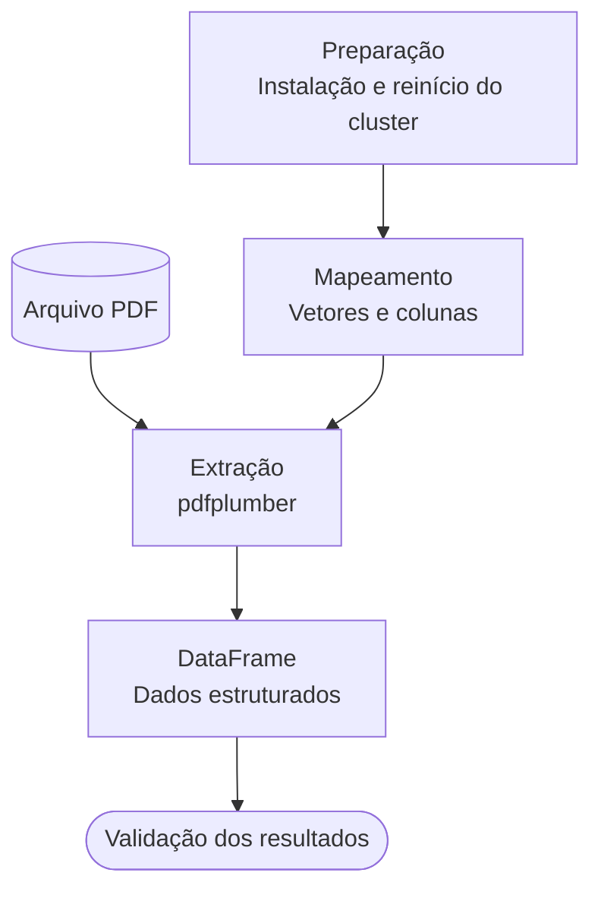
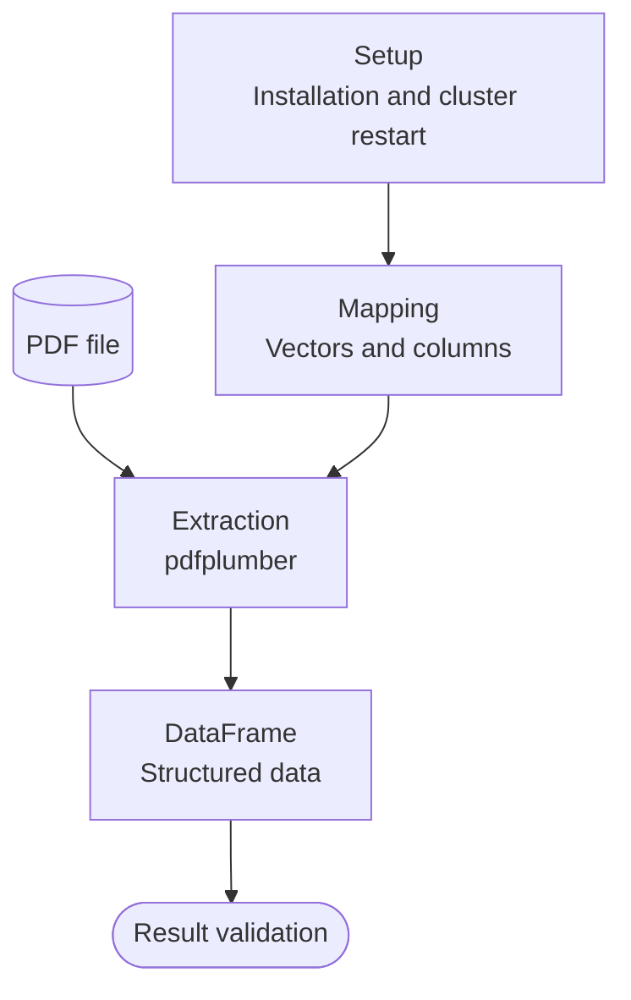

# Conversor de arquivos PDFs em dados tabulares

**🌐 Idioma / Language:** [Português](#pt) | [English](#en)

---

## 🇧🇷 Português

### 📌 Sobre o projeto

O **Conversor de arquivos PDFs em dados tabulares** é um notebook que extrai informações específicas de arquivos PDF e as converte em tabelas estruturadas, em ambientes Databricks.

O objetivo é automatizar a extração de dados de PDFs padronizados e gerar DataFrames prontos para análise, integração ou exportação.

### 🗂️ Fonte de dados

- **Origem:** arquivos PDF padronizados.
- **Conteúdo:** informações específicas localizadas por vetores de coordenadas.
- **Observação:** o caminho do arquivo deve estar correto e acessível no ambiente.

### ⚙️ Desenvolvimento

1. **Preparação do ambiente:** instalação da biblioteca e reinicialização do cluster.
2. **Mapeamento:** definição dos vetores de coordenadas e das colunas, na mesma ordem.
3. **Extração:** leitura das áreas definidas com `pdfplumber`.
4. **Estruturação:** montagem do DataFrame.
5. **Validação:** teste e conferência dos resultados. Os vetores devem ser ajustados ao layout do PDF.

**Arquivo PDF**

### 🔀 Fluxo do projeto

### ✨ Funcionalidades

- Extração de dados por vetores de coordenadas
- Mapeamento das colunas
- Geração de DataFrames

### 💼 Valor gerado e ganhos de negócio

O projeto transforma informações de arquivos PDF em tabelas estruturadas. A solução pode gerar:

| Valor gerado | Ganho de negócio potencial |
|---|---|
| Extração automatizada | Mais agilidade, menos custos e riscos operacionais |
| Dados estruturados | Relatórios, insights e decisões mais rápidas |
| Processo padronizado | Mais rastreabilidade e governança |
| Lógica adaptável | Expansão para outras páginas, documentos e áreas |
| Dados disponíveis para análise | Alinhamento entre TI e áreas estratégicas |

> **Nota:** os ganhos são potenciais e não foram medidos. A expansão exige adaptar a lógica de extração.

### 🛠️ Tecnologias utilizadas

| Tecnologia | Finalidade |
|---|---|
| Databricks | Ambiente de execução do notebook |
| pdfplumber | Extração dos dados do PDF |
| DataFrame | Estruturação dos dados |

[⬆️ Voltar ao topo](#topo)

---

## 🇺🇸 English

### 📌 About the project

**PDF files to tabular data converter** is a notebook that extracts specific information from PDF files and converts it into structured tables, in Databricks environments.

Its goal is to automate data extraction from standardized PDFs and generate DataFrames ready for analysis, integration or export.

### 🗂️ Data source

- **Origin:** standardized PDF files.
- **Content:** specific information located by coordinate vectors.
- **Note:** the file path must be correct and accessible in the environment.

### ⚙️ Development

1. **Environment setup:** library installation and cluster restart.
2. **Mapping:** definition of coordinate vectors and columns, in the same order.
3. **Extraction:** reading the defined areas with `pdfplumber`.
4. **Structuring:** DataFrame creation.
5. **Validation:** testing and checking the results. Vectors must be adjusted to the PDF layout.

**PDF file**

### 🔀 Project flow

### ✨ Features

- Data extraction by coordinate vectors
- Column mapping
- DataFrame generation

### 💼 Value delivered and business gains

The project turns information from PDF files into structured tables. The solution can deliver:

| Value delivered | Potential business gain |
|---|---|
| Automated extraction | More agility, lower operational costs and risks |
| Structured data | Reports, insights and faster decisions |
| Standardized process | Better traceability and governance |
| Adaptable logic | Expansion to other pages, documents and areas |
| Data available for analysis | Alignment between IT and strategic areas |

> **Note:** these gains are potential and have not been measured. Expansion requires adapting the extraction logic.

### 🛠️ Technologies used

| Technology | Purpose |
|---|---|
| Databricks | Notebook runtime environment |
| pdfplumber | PDF data extraction |
| DataFrame | Data structuring |

[⬆️ Back to top](#topo)
