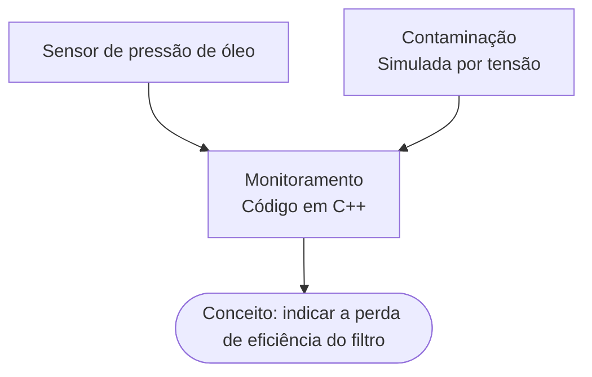
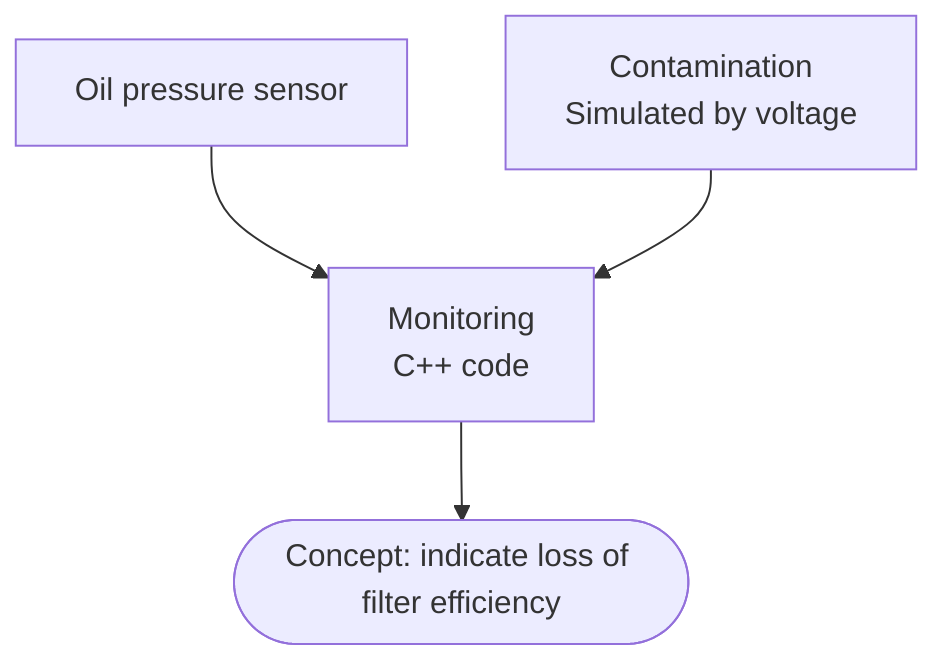

# Monitor de pressão de óleo

**🌐 Idioma / Language:** [Português](#pt) | [English](#en)

---

## 🇧🇷 Português

### 📌 Sobre o projeto

O **Monitor de Pressão de Óleo** foi desenvolvido para determinar a vida útil do filtro de óleo veicular. Foi meu trabalho de conclusão de curso em Mecânica Automobilística na FATEC Santo André, durante o período de lockdown, e meu primeiro projeto com programação.

O filtro de óleo normalmente é trocado após uma quilometragem ou um período determinado, o que gera resíduos e polui o meio ambiente. A ideia é monitorar quando o filtro de fato perde a eficiência, para que seja usado até o fim da sua vida útil real.

### 🗂️ Fonte de dados

- **Origem:** simulação na plataforma TinkerCad.
- **Conteúdo:** pressão de óleo e nível de contaminação, este representado por tensão.
- **Observação:** não houve teste prático.

> [!NOTE]
> Por falta de recursos, o projeto apenas ilustrou o conceito geral da ideia, sem teste prático, por ter sido feito em um momento inviável.
> O parâmetro de contaminação (ou monitoramento da contaminação) foi substituído por **tensão**.

### ⚙️ Desenvolvimento

1. **Definição do tema:** reuniões com os orientadores.
2. **Concepção:** monitoramento da contaminação do óleo em conjunto com um sensor de pressão de óleo.
3. **Simulação:** criação do projeto no TinkerCad, com adaptações devido às limitações da plataforma.
4. **Programação:** código escrito em C++.

### 🔀 Fluxo do projeto

### ✨ Funcionalidades

- Simulação do monitoramento da pressão de óleo
- Representação da contaminação do óleo por meio de tensão

### 💼 Valor gerado e ganhos de negócio

O projeto ilustra um conceito de troca do filtro baseada na sua condição. Aplicada e validada em um cenário real, a solução pode gerar:

| Valor gerado | Ganho de negócio potencial |
|---|---|
| Acompanhamento da eficiência do filtro | Uso do filtro até o fim da vida útil real |
| Troca baseada na condição | Menos resíduos |
| Menos descartes antecipados | Redução dos danos ao meio ambiente |

> **Nota:** os ganhos são potenciais. O conceito não foi testado na prática nem medido.

### 🛠️ Tecnologias utilizadas

| Tecnologia | Finalidade |
|---|---|
| TinkerCad | Criação e simulação do projeto |
| C++ | Programação |

### 🔗 Acesso

O projeto está salvo no TinkerCad: [Leitor de pressao de óleo](https://www.tinkercad.com/things/eCA6acY9CCD-leitura-de-pressao-de-oleo/editel?returnTo=https%3A%2F%2Fwww.tinkercad.com%2Fdashboard)

### 📚 Aprendizados

Eu nunca tinha escrito um único código nem feito qualquer curso de programação, e precisei desenvolver o trabalho de conclusão em um momento muito difícil para o mundo. Começou uma corrida contra o tempo, pois havia um prazo de entrega.

A definição do tema foi difícil, já que as opções ficaram escassas. Era minha primeira graduação, em um curso no qual a maioria dos projetos envolve protótipos e muita mão na massa. Depois de conversar com orientadores, precisei encontrar uma forma de fazer o projeto online, e nas buscas encontrei o TinkerCad.

O desenvolvimento foi trabalhoso: muitas madrugadas tentando escrever o código, várias adaptações por causa das limitações da plataforma e muito aprendizado de C++.

[⬆️ Voltar ao topo](#topo)

---

## 🇺🇸 English

### 📌 About the project

The **Oil Pressure Monitor** was developed to determine the lifespan of a vehicle oil filter. It was my final capstone project for the Automotive Mechanics course at FATEC Santo André, during the lockdown period, and my first project involving programming.

Oil filters are typically replaced after a certain mileage or time period, which leads to waste and environmental pollution. The idea is to monitor when the filter actually loses its efficiency, so it is used until the real end of its useful life.

### 🗂️ Data source

- **Origin:** simulation on the TinkerCad platform.
- **Content:** oil pressure and contamination level, the latter represented by voltage.
- **Note:** no practical testing was carried out.

> [!NOTE]
> Due to a lack of resources, the project only illustrated the general concept of the idea, without practical testing, as it was developed during an unfeasible period.
> The "contamination" (or "contamination monitoring") parameter was replaced by **voltage** for simulation purposes.

### ⚙️ Development

1. **Theme definition:** meetings with advisors.
2. **Concept:** oil contamination monitoring combined with an oil pressure sensor.
3. **Simulation:** project built in TinkerCad, with adaptations due to platform limitations.
4. **Programming:** code written in C++.

### 🔀 Project flow

### ✨ Features

- Simulated oil pressure monitoring
- Oil contamination represented by voltage

### 💼 Value delivered and business gains

The project illustrates a concept for condition-based filter replacement. Applied and validated in a real scenario, the solution can deliver:

| Value delivered | Potential business gain |
|---|---|
| Tracking of filter efficiency | Filter used until the real end of its useful life |
| Condition-based replacement | Less waste |
| Fewer early disposals | Reduced environmental damage |

> **Note:** these gains are potential. The concept has not been tested in practice or measured.

### 🛠️ Technologies used

| Technology | Purpose |
|---|---|
| TinkerCad | Project design and simulation |
| C++ | Programming |

### 🔗 Access

The project is saved on TinkerCad: [Oil pressure monitor](https://www.tinkercad.com/things/eBodkIf6JkG-publico-leitura-de-pressao-de-oleo?sharecode=QApwC96Fn0rooluCqMepgcrxkiIbAaC_hmgHPhg76UU)

### 📚 Lessons learned

I had never written a single line of code or taken any programming course, and I had to develop my graduation project during a very difficult time for the world. A race against time began, as there was a strict deadline.

Choosing a theme was hard, since options had become scarce. This was my first undergraduate degree, in a course where most projects involve prototypes and significant hands-on work. After talking with advisors, I had to find a way to carry out the project online, and during my search I discovered TinkerCad.

Development was labor-intensive: many late nights trying to write code, several adaptations due to platform limitations and a lot of learning about C++.

[⬆️ Back to top](#topo)
